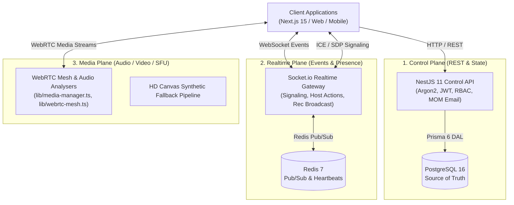

# Mivo — Unified Real-Time Communication Platform

<div align="center">

```
  __  __ _____     ______  
 |  \/  |_ _\ \   / / __ \ 
 | |\/| || | \ \ / / |  | |
 | |  | || |  \ V /| |__| |
 |_|  |_|___|  \_/  \____/ 
```

**Next-Generation Unified Real-Time Communication & Social Collaboration Engine**

[](https://www.typescriptlang.org/)
[](https://turbo.build/)
[](https://nextjs.org/)
[](https://nestjs.com/)
[](https://www.prisma.io/)
[](https://www.postgresql.org/)
[](https://redis.io/)
[](#-modular-testing-architecture)
[](#license)

[Features](#-key-features) • [Architecture](#-three-plane-architecture) • [User Guide](file:///docs/USER_GUIDE.md) • [Testing](file:///tests) • [Monorepo Layout](#-monorepo-ecosystem) • [Quickstart](#-local-development-quickstart) • [Prompts](file:///prompts)

---

</div>

## 🌟 Overview

**Mivo** is an ultra-low-latency real-time communication platform designed to overcome the friction of legacy chat and conferencing software. By introducing the **Unified Communication Room** paradigm, Mivo eliminates the artificial divide between static text channels and isolated voice calls.

### ⚡ The Unified Room Paradigm

In conventional tools (e.g. Discord, Slack, Teams), channels are hard-locked by type: a text channel cannot host video, and joining a voice channel creates an isolated voice lobby disconnected from context. 

**Mivo rooms are dynamic stages.** A single room seamlessly morphs across five operational modes at the click of a switch without tearing down connections, disconnecting participants, or losing context:

| Mode | Capability & Experience | Primary Use Case |
| :--- | :--- | :--- |
| `TEXT` | Focused chat stream with real-time markdown, instant message translation & TTS | Async & sync textual discussion |
| `VOICE` | Low-latency voice huddle with active speaker pulse rings & green soundwave visualizers | Casual drop-in audio conversations |
| `VIDEO` | Responsive auto-arranging HD video grid with HTML5 drag-and-drop & spotlight pinning | Standups, team syncs, meetings |
| `SCREEN_SHARE` | High-framerate interactive presentation viewport with floating PiP presenter | Pair programming, code reviews, demos |
| `STREAM` | Single-broadcaster stage with audience participation & live broadcast badge | Keynotes, gaming streams, town halls |

---

## 🚀 Key Features

* 🎛️ **Unified Room Stage**: Morph room context between `TEXT`, `VOICE`, `VIDEO`, `SCREEN_SHARE`, and `STREAM` dynamically.
* 🔀 **Smart Auto-Arranging Grid & Drag & Drop**: Grab participant tiles by the handle to reorder them on the fly, or click **"Auto-Arrange Grid"** to restore optimal speaker balance.
* 📌 **Spotlight Focus Mode**: Pin any speaker into a dominant 16:9 hero stage with an attendee filmstrip below.
* 🖼️ **Floating Picture-in-Picture (PiP) Presenter**: Multitask and view all participant live video feeds in a draggable floating window while presenting slides or code.
* 🔊 **Individual Peer Volume Sliders**: Adjust each speaker's volume independently from 0% to 200%.
* 👑 **Host & Admin Moderation**: Remote mute participants across the room, hand over host privileges, or evict attendees via real-time WebSocket signals (`ROOM_HOST_ACTION`).
* 🌍 **Multilingual AI Translation & Audio (TTS)**: In-chat instant translation and live speech transcription across 12+ languages (Spanish 🇪🇸, French 🇫🇷, German 🇩🇪, Hindi 🇮🇳, Japanese 🇯🇵, Chinese 🇨🇳) with native audio playback.
* 📋 **Whisper AI Meeting Scribe & Automated MOM**: Real-time speech dictation, Markdown scratchpad, structured Minutes of Meeting (MOM) document generation, and 1-click email dispatch.
* 🔴 **Permission-Gated Recording & Consent Compliance**: Host permission checks, unmissable room-wide consent alert banner (`RecordingConsentBanner.tsx`), persistent live elapsed `REC` timer badge, and automatic `.webm` video download.
* 📖 **In-App Interactive Documentation Hub**: Floating `User Docs` trigger with a folderized directory and real-time search modal (`InteractiveDocsModal.tsx`).
* 🛡️ **Zero-Client-Trust Granular RBAC**: 16 fine-grained permissions evaluated strictly server-side before every mutation.

---

## 🏛️ Three-Plane Architecture

Mivo strictly enforces a **Three-Plane Separation of Concerns** to guarantee high throughput, fault isolation, and sub-second failover recovery:



1. **Control Plane (`apps/server`)**: 
   * Authoritative REST API for authentication, user profiles, community hierarchy, channel structures, role configurations, and MOM email dispatching.
   * Backed by PostgreSQL 16 with Prisma 6 for relational integrity and strict ACID guarantees.
2. **Realtime Plane (`apps/server/src/realtime`)**: 
   * Ultra-low-latency WebSocket gateway powered by Socket.io and Redis 7 Pub/Sub.
   * Handles ephemeral user presence, dynamic room mode transitions, host moderation actions, and recording state broadcasts.
3. **Media Plane (`apps/web/src/lib`)**: 
   * WebRTC mesh manager, hardware device acquisition (Mic, Camera, Screen), Web Audio API spectrum decibel analysers, and HTML5 `MediaRecorder` capture.

---

## 📂 Modular Testing Architecture (22/22 Suites Passing)

All test suites and fixtures are organized by feature domain in `tests/`:

```
tests/
├── 📄 run-all-tests.js                         # Master runner traversing all 7 modules
├── 📁 fixtures/                                # Seed fixtures (users, workspaces, transcripts)
└── 📁 modules/                                 # 7 Core Feature Modules
    ├── 📁 auth-identity/                       # Unit, Integration & E2E Auth suites
    ├── 📁 communities-rbac/                    # Workspace & Channel hierarchy suites
    ├── 📁 messaging-chat/                      # Real-time chat & translation suites
    ├── 📁 webrtc-media-stage/                  # WebRTC mesh & stage mode suites
    ├── 📁 host-moderation/                     # Remote mute, kick & host transfer suites
    ├── 📁 ai-scribe-mom/                       # Whisper dictation & MOM email suites
    └── 📁 recording-compliance/                # Session recording & consent banner suites
```

Run all 22 modular test suites anytime with:
```bash
pnpm test:suites
```

---

## 👥 Demo Profiles (Password: `Password123!`)

* **👑 Dev Admin** (`dev@mivo.app`): Platform Architect & Community Owner
* **🎨 Alex Rivera** (`alex@mivo.app`): Staff Designer & Admin
* **⚡ Sarah Connor** (`sarah@mivo.app`): Principal Backend Lead
* **🇪🇸 Carlos Mendoza** (`carlos@mivo.app`): Frontend Lead (Spanish Speaker)
* **🇮🇳 Priya Sharma** (`priya@mivo.app`): Cloud Architect (Hindi Speaker)
* **📻 Elena Rostova** (`elena@mivo.app`): Media SFU Infrastructure Specialist

---

## 💻 Local Development Quickstart

### Prerequisites
* **Node.js**: `v20.x` or `v22.x+`
* **PNPM**: `v9.x` or `v10.x`
* **Docker & Docker Compose**: `v24.x+`

### 1. Clone & Install Dependencies
```bash
git clone https://github.com/akshaykumar33/Mivo.git
cd Mivo
pnpm install
```

### 2. Launch Local Infrastructure
Start PostgreSQL, Redis, and MinIO via Docker Compose:
```bash
docker compose -f docker/docker-compose.yml up -d
```

### 3. Initialize Database & Seed
```bash
# Push schema migrations and generate Prisma Client
pnpm --filter @mivo/database db:push

# Seed default system permissions, roles, and demo accounts
pnpm --filter @mivo/database db:seed
```

### 4. Boot All Applications
```bash
pnpm dev
```

* **Web Application**: [`http://localhost:3000`](http://localhost:3000)
* **Backend API**: [`http://localhost:4000/api/v1`](http://localhost:4000/api/v1)
* **MinIO Storage Console**: [`http://localhost:9001`](http://localhost:9001)

### 5. Run Verification & Test Suites
```bash
# Run all 22 modular test suites
pnpm test:suites

# Typecheck all monorepo packages
pnpm check:types
```

---

## 📜 Prompts & Specifications Catalog

All systems and architectural requirements are documented in modular prompt specifications:
* [`docs/USER_GUIDE.md`](file:///docs/USER_GUIDE.md) — Comprehensive in-depth platform user manual.
* [`prompts/ui_prompt.md`](file:///prompts/ui_prompt.md) — Luxury Obsidian UI design system & ergonomics.
* [`prompts/webrtc_media_pipeline_prompt.md`](file:///prompts/webrtc_media_pipeline_prompt.md) — WebRTC calling, hardware capture & stage tiles.
* [`prompts/ai_translation_mom_prompt.md`](file:///prompts/ai_translation_mom_prompt.md) — Multilingual translation, TTS & automated MOM.
* [`prompts/meeting_recording_consent_prompt.md`](file:///prompts/meeting_recording_consent_prompt.md) — Permission-gated recording & consent banner.
* [`prompts/channel_room_governance_prompt.md`](file:///prompts/channel_room_governance_prompt.md) — Channel privacy, RBAC & lifecycle.
* [`prompts/host_moderation_pip_prompt.md`](file:///prompts/host_moderation_pip_prompt.md) — Host moderation, floating PiP & smart grid.
* [`prompts/comprehensive_testing_architecture_prompt.md`](file:///prompts/comprehensive_testing_architecture_prompt.md) — Modular testing pyramid blueprint.

---

## ⚖️ License

**Copyright © 2026 Wysbryx / Mivo. All Rights Reserved.**
