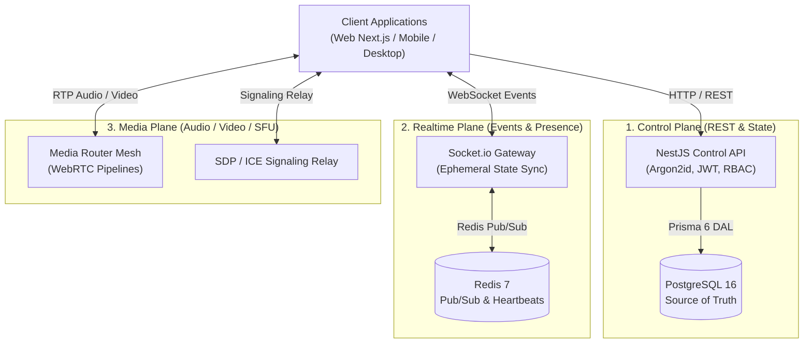

# Mivo — Unified Real-Time Communication Platform

<div align="center">

```
  __  __ _____     ______  
 |  \/  |_ _\ \   / / __ \ 
 | |\/| || | \ \ / / |  | |
 | |  | || |  \ V /| |__| |
 |_|  |_|___|  \_/  \____/ 
```

**Next-Generation Unified Real-Time Communication & Social Collaboration Engine**

[](https://www.typescriptlang.org/)
[](https://turbo.build/)
[](https://nextjs.org/)
[](https://nestjs.com/)
[](https://www.prisma.io/)
[](https://www.postgresql.org/)
[](https://redis.io/)
[](#license)

[Features](#-key-features) • [Architecture](#-three-plane-architecture) • [Monorepo Layout](#-monorepo-ecosystem) • [Quickstart](#-local-development-quickstart) • [Roadmap](#-phased-roadmap) • [Documentation](file:///docs/ARCHITECTURE.md)

---

</div>

## 🌟 Overview

**Mivo** is an ultra-low-latency real-time communication platform designed to overcome the friction of legacy chat and conferencing software. By introducing the **Unified Communication Room** paradigm, Mivo eliminates the artificial divide between static text channels and isolated voice calls.

### ⚡ The Unified Room Paradigm

In conventional tools (e.g. Discord, Slack, Teams), channels are hard-locked by type: a text channel cannot host video, and joining a voice channel creates an isolated voice lobby disconnected from context. 

**Mivo rooms are dynamic stages.** A single room seamlessly morphs across five operational modes at the click of a switch without tearing down connections, disconnecting participants, or losing context:

| Mode | Capability & Experience | Primary Use Case |
| :--- | :--- | :--- |
| `TEXT` | Focused chat stream with real-time markdown & media | Async & sync textual discussion |
| `VOICE` | Low-latency voice huddle with active speaker pulse rings | Casual drop-in audio conversations |
| `VIDEO` | Responsive auto-arranging HD video grid | Standups, team syncs, meetings |
| `SCREEN_SHARE` | High-framerate interactive presentation viewport | Pair programming, code reviews, demos |
| `STREAM` | Single-broadcaster stage with audience participation | Keynotes, gaming streams, town halls |

---

## 🏛️ Three-Plane Architecture

Mivo strictly enforces a **Three-Plane Separation of Concerns** to guarantee high throughput, fault isolation, and sub-second failover recovery:



1. **Control Plane (`apps/server`)**: 
   * Authoritative REST API for authentication, user profiles, community hierarchy, channel structures, and role configurations.
   * Backed by PostgreSQL 16 with Prisma 6 for complete relational integrity and strict ACID guarantees.
2. **Realtime Plane (`apps/server/src/realtime`)**: 
   * Ultra-low-latency WebSocket gateway powered by Socket.io and Redis 7 Pub/Sub.
   * Handles ephemeral user presence heartbeats, dynamic room mode transitions, and participant state updates.
3. **Media Plane (`apps/web/src/features/rooms/MediaStage.tsx`)**: 
   * WebRTC signaling relay and dynamic media stage supporting responsive video grids, screen capture pipelines, and real-time active speaker animations.

---

## 📦 Monorepo Ecosystem

Mivo is structured as an optimized Turborepo monorepo with strict package boundaries:

```text
mivo/
├── apps/
│   ├── server/           # NestJS 11 Control Plane REST API & WebSocket Gateway
│   └── web/              # Next.js 15 App Router Frontend with Dark Glassmorphism UI
├── packages/
│   ├── shared/           # Single-source-of-truth Zod schemas, DTOs, & event catalogs
│   ├── database/         # Prisma 6 schema, migrations, client singleton, & seeder
│   └── ui/               # Reusable Tailwind design tokens & accessible UI primitives
├── docker/               # Local PostgreSQL, Redis, and MinIO Docker Compose services
├── docs/                 # Architectural Decision Records (ADRs) & system specifications
└── prompts/              # Engineering protocols & AI code generation instructions
```

| Package / App | Description | Technologies |
| :--- | :--- | :--- |
| [`@mivo/shared`](file:///packages/shared) | Shared contracts, DTO types, permission constants, Zod schemas | TypeScript, Zod, Vitest |
| [`@mivo/database`](file:///packages/database) | Database client singleton, Prisma models, migrations, seeder | Prisma 6, PostgreSQL |
| [`@mivo/ui`](file:///packages/ui) | Design tokens, glowing accents, Avatar, Button, Input, Modal | Tailwind CSS, Lucide |
| [`@mivo/server`](file:///apps/server) | Control & Realtime backend services, Auth, RBAC, Gateway | NestJS 11, Socket.io, Jest |
| [`@mivo/web`](file:///apps/web) | Interactive web client, RoomModeSwitcher, MediaStage | Next.js 15, Zustand, React 19 |

---

## 🚀 Key Features

* 🎛️ **Unified Room Stage**: Morph room context between `TEXT`, `VOICE`, `VIDEO`, `SCREEN_SHARE`, and `STREAM` seamlessly.
* 🛡️ **Zero-Client-Trust Granular RBAC**: 16 fine-grained permissions evaluated strictly server-side before every mutation.
* ⚡ **Ephemeral Presence Engine**: Sub-second user online/offline/idle presence powered by Redis heartbeat pipelines.
* 🔐 **Enterprise Auth**: Argon2id password hashing, stateless short-lived JWTs, and secure HttpOnly refresh token rotation.
* 🎨 **Bespoke Glassmorphism Design**: High-contrast dark theme with curated HSL glow states and active speaker animations.
* 🐳 **1-Click Containerized Dev**: Fully automated local database, cache, and object storage infrastructure.

---

## 🛠️ Technology Stack

| Layer | Primary Technology | Rationale & Trade-offs |
| :--- | :--- | :--- |
| **Frontend Framework** | **Next.js 15 (App Router)** | Server-side rendering, streaming layout shell, and fast routing |
| **State Management** | **Zustand** | Minimal boilerplate, synchronous selector updates, zero re-render bloat |
| **Styling & Theme** | **Tailwind CSS + HSL Tokens** | Fine-grained design token control and glassmorphic surface rendering |
| **Backend Framework** | **NestJS 11** | Modular enterprise architecture, dependency injection, and clean boundaries |
| **ORM & Database** | **Prisma 6 + PostgreSQL 16** | Strong schema typing, automatic migrations, and ACID transaction safety |
| **Realtime Engine** | **Socket.io + Redis 7** | Reliable room fanouts, automatic fallback, and multi-node horizontal scaling |
| **Password Hashing** | **Argon2id** | Industry-standard memory-hard hashing resistant to GPU cracking |
| **Build System** | **Turborepo + PNPM** | Incremental task caching, parallel execution, and strict workspace linking |

---

## 💻 Local Development Quickstart

### Prerequisites
* **Node.js**: `v20.x` or `v22.x+`
* **PNPM**: `v9.x` or `v10.x`
* **Docker & Docker Compose**: `v24.x+`

### 1. Clone & Install Dependencies
```bash
git clone <repository-url>
cd Mivo
pnpm install
```

### 2. Launch Local Infrastructure
Start PostgreSQL, Redis, and MinIO via Docker Compose:
```bash
docker compose -f docker/docker-compose.yml up -d
```

### 3. Initialize Database & Seed Roles
```bash
# Push schema migrations and generate Prisma Client
pnpm --filter @mivo/database db:push

# Seed default system permissions, roles, and admin user
pnpm --filter @mivo/database db:seed
```

### 4. Boot All Applications
```bash
pnpm dev
```

* **Web Application**: [`http://localhost:3000`](http://localhost:3000)
* **Backend API**: [`http://localhost:4000/api/v1`](http://localhost:4000/api/v1)
* **MinIO Storage Console**: [`http://localhost:9001`](http://localhost:9001)

### 5. Verification & Test Suite
```bash
# Typecheck all packages
pnpm check:types

# Run all unit tests
pnpm test

# Build production bundles
pnpm build
```

---

## 🔒 Security Architecture

Mivo operates under a **Zero-Client-Trust** security posture:
1. **Server-Side Authorization**: Roles sent in HTTP request bodies or WebSocket payloads are ignored. Every capability is validated against database-persisted memberships using `PermissionsGuard`.
2. **Token Rotation & Revocation**: Refresh tokens are stored in secure `HttpOnly`, `SameSite=Lax` cookies. Database session records allow instant remote session invalidation across devices.
3. **Boundary Validation**: Every API endpoint and WebSocket handler validates inbound data structures through strict Zod schemas before hitting business logic.
4. **Information Leak Protection**: Global `HttpExceptionFilter` intercepts all unexpected errors and strips internal stack traces before returning clean, standardized error payloads.

---

## 🗺️ Phased Roadmap

* [x] **Phase 1 (V1 Foundation)**: Monorepo workspace, Three-Plane architecture, NestJS REST API, Socket.io presence, Prisma PostgreSQL models, `@mivo/ui` design system, and unified room switcher frontend.
* [ ] **Phase 2 (V2 Real-Time Chat Subsystem)**: Direct messaging (1-to-1 & group DMs), cursor-paginated chat history, emoji reactions, and thread replies.
* [ ] **Phase 3 (V3 Media & SFU Pipelines)**: Dedicated Mediasoup / LiveKit SFU binary router integration, simulcast video, and screen audio sharing.
* [ ] **Phase 4 (V4 Object Storage & Attachments)**: Presigned S3 direct multipart file uploads, virus scanning webhooks, and image thumbnail pipelines.
* [ ] **Phase 5 (V5 Moderation & Community Ops)**: Granular channel overrides, member timeout/kick/ban workflows, audit log viewer, and invite links.
* [ ] **Phase 6 (V6 Native & Desktop Shells)**: Electron desktop packaging, global hotkeys, background noise cancellation (RNNoise), and push notifications.
* [ ] **Phase 7 (V7 Enterprise & Federation)**: SAML/OIDC SSO, end-to-end encrypted room options, and multi-region read replicas.

---

## 📜 Contribution & Engineering Protocols

All development in this repository is governed by:
* [prompts/init_prompt.md](file:///prompts/init_prompt.md) — 50 Master AI software engineering rules.
* [prompts/commit_prompt.md](file:///prompts/commit_prompt.md) — Commit anatomy, branch taxonomy, and PR guidelines.
* [prompts/readme_prompt.md](file:///prompts/readme_prompt.md) — Project documentation standards.

---

## ⚖️ License

**Copyright © 2026 Wysbryx / Mivo. All Rights Reserved.**

This software, its source code, documentation, and associated assets are proprietary and confidential property of Wysbryx. Unauthorized copying, distribution, modification, public display, reverse engineering, or commercial exploitation via SaaS without express written permission is strictly prohibited. See [LICENSE](file:///LICENSE) for complete terms.
