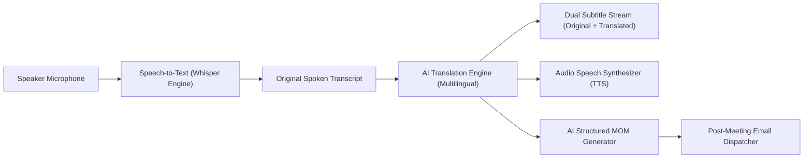

# Mivo AI Multilingual Translation, Audio Synthesis & Minutes of Meeting (MOM) Specification

## 1. Overview & Vision
Mivo provides zero-barrier real-time communication across linguistic boundaries. When users speak or chat in different languages (e.g. English, Spanish, French, German, Hindi, Japanese, Chinese, etc.), Mivo automatically transcribes, translates, and synthesizes speech in real-time, while generating professional, structured Minutes of Meeting (MOM) post-call.

---

## 2. Core Capabilities & Architecture

### A. Real-Time Dual-Language Subtitles & Chat Translation
1. **Live Subtitles**:
   - Displays real-time subtitle cards below active speakers with both:
     - **Original Speech**: E.g. *"Estamos listos para desplegar el nuevo clúster de servidores."*
     - **Translated Target**: E.g. *"We are ready to deploy the new server cluster."*
2. **Real-Time In-Chat Translation**:
   - Every chat message includes an instant "Translate" button or automatic room-wide translation to the user's preferred local language.

### B. Live Audio Translation (Speech Synthesis / TTS)
- When a remote participant speaks in Language A, the listener can enable **"Translated Voice Channel"** to hear synthesized audio translated into Language B via HTML5 `SpeechSynthesis` API.

### C. Automated Structured Minutes of Meeting (MOM)
The MOM generator produces a clean, executive-ready document containing:
- **Meeting Header**: Title, Date/Time, Duration, Host & Attendees.
- **Executive Summary**: 3-4 sentence high-level overview.
- **Key Discussion Points**: Categorized by topic and speaker.
- **Decisions Made**: Explicit list of resolved agenda items.
- **Action Items Table**: Task description, Assignee, Priority, and Due Date.
- **Full Bilingual Transcript**: Searchable, timecoded transcript.
- **Automated Email Delivery**: Immediate dispatch to all attendee email inboxes.

---

## 3. Supported Languages
- English (`en`), Spanish (`es`), French (`fr`), German (`de`), Hindi (`hi`), Japanese (`ja`), Chinese Mandarin (`zh`), Portuguese (`pt`), Italian (`it`), Russian (`ru`), Korean (`ko`), Arabic (`ar`).
