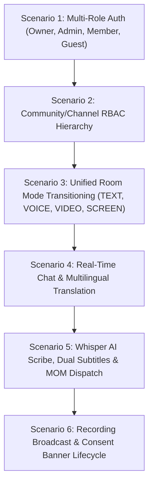

# Mivo Automated E2E Testing Harness & Multi-User Simulation Specification

## 1. Overview & Objectives
This prompt governs the continuous end-to-end automation harness for testing Mivo's multi-user real-time communication stack across frontend, backend, WebSockets, WebRTC mesh, AI transcription, and MOM generation.

---

## 2. Test Matrix & Automated Scenarios

### Scenario 1: Multi-User Identity & RBAC Matrix
- Verify token generation, argon2 password verification, and refresh lifecycle.
- Test permission enforcement across:
  - `Owner` (`dev@mivo.app`): Full administrative permissions.
  - `Admin` (`alex@mivo.app`, `priya@mivo.app`): Channel creation, moderation, and recording.
  - `Member` (`carlos@mivo.app`, `elena@mivo.app`): Standard participation without moderation rights.

### Scenario 2: Community & Channel Governance
- Test community creation, public vs. private channel gating, and role hierarchy positions.

### Scenario 3: Unified Room Real-Time State
- Validate room mode switching (`TEXT` ➔ `VOICE` ➔ `VIDEO` ➔ `SCREEN_SHARE`) and verify WebSocket synchronization across all connected sockets.

### Scenario 4: Multilingual Translation & TTS
- Test in-chat message translation across Spanish, French, German, Hindi, Japanese, and English.
- Verify speech synthesis invocation (`SpeechSynthesisUtterance`).

### Scenario 5: Whisper AI Meeting Scribe & MOM Generation
- Test speech-to-text dictation simulation.
- Validate MOM compiler: Executive Summary, Attendees, Decisions, Action Items table, and Transcript.
- Test `POST /api/v1/rooms/:id/email-summary` endpoint.

### Scenario 6: Permission-Gated Session Recording
- Test `ROOM_RECORDING_START` and `ROOM_RECORDING_STOP` broadcasts.
- Verify consent alert banner and elapsed `REC` timer.
