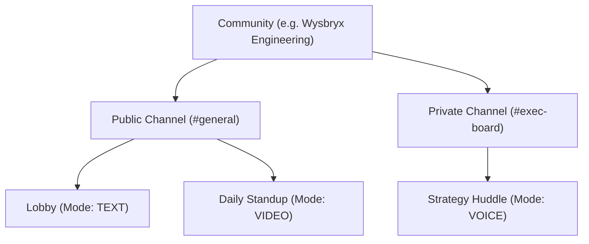

# Mivo Channel & Room Governance, RBAC & Lifecycle Specification

## 1. Hierarchy & Architecture
Mivo organizes real-time communication into a flexible, 3-tier structure:

---

## 2. Channel Privacy & Room Lifecycle

### A. Public vs. Private Channels
1. **Public Channels (`isPrivate: false`)**:
   - Visible to all community members.
   - Any member can browse, join rooms, and chat.
2. **Private Channels (`isPrivate: true`)**:
   - Hidden from general members.
   - Accessible only to Community Owners, Admins, or explicitly assigned roles.

### B. Granular Role-Based Access Control (RBAC)
- **👑 Owner (`dev@mivo.app`)**: Full permissions across channels, rooms, roles, and settings.
- **⚡ Admin (`alex@mivo.app`, `sarah@mivo.app`)**: Can create/edit/delete channels and rooms, moderate participants, and record calls.
- **👤 Member (`elena@mivo.app`)**: Standard participant (can chat, speak, turn on video, share screen, but cannot delete rooms or moderate).

### C. Room Lifecycle & Capacity Limits
1. **Persistence**:
   - Rooms are persistent with soft-deletion (`deletedAt`).
   - Chat history, recordings, and transcripts remain saved until explicitly deleted by an Admin.
2. **Capacity Limits**:
   - `maxCapacity` field enforces room-level limits (e.g. 100 for voice, 25 for video mesh, 1,000+ for live broadcasts).
