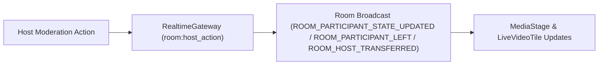

# Mivo Host Moderation, Picture-in-Picture (PiP) & Smart Grid Specification

## 1. Overview & Architecture
Mivo gives Meeting Hosts and Admins total control over session flow, moderation, and layout ergonomics with real-time WebSocket synchronization.

---

## 2. Core Capabilities

### A. Host & Admin In-Meeting Moderation
1. **Remote Mute (`action: 'MUTE'`)**:
   - Host can force-mute any participant across the entire room.
2. **Transfer Host (`action: 'TRANSFER_HOST'`)**:
   - Host can hand over host privileges to another connected attendee.
3. **Evict / Kick (`action: 'KICK'`)**:
   - Host can remove disruptive participants from the call immediately.

### B. Floating Picture-in-Picture (PiP) Presenter Stage
- **Draggable Multi-Tile Widget**:
  - Automatically pops up during screen sharing or when toggled via the **PiP button**.
  - Displays all remote video feeds + local video preview + active audio decibel bars in a compact floating box on the bottom-right.
  - Allows presenters to view audience reactions without switching away from their shared window.

### C. Smart Auto-Arranging Grid Layout
- **Dynamic Columns**: Auto-calculates optimal layout (`1 ➔ 1 col`, `2 ➔ 2 cols`, `3-4 ➔ 2x2`, `5-9 ➔ 3x3`).
- **Reset Button**: "Auto-Arrange Grid" button restores optimal speaker layout after custom drag-and-drop actions.
