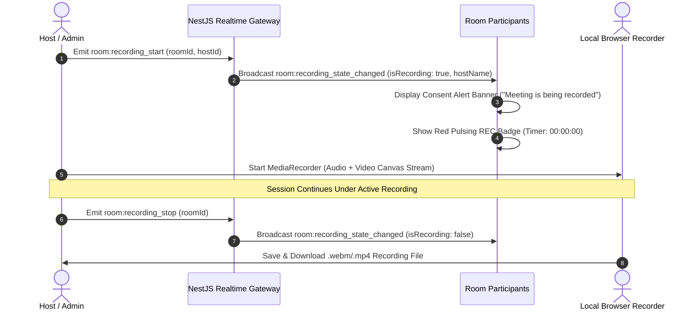

# Mivo Permission-Gated Meeting Recording & Consent System Specification

## 1. Overview & Compliance
To ensure total security, transparency, and legal compliance (GDPR, HIPAA, and CCPA two-party consent laws), Mivo enforces strict, permission-gated call recording with room-wide broadcast alerts, persistent visual badges, and automated consent management.

---

## 2. System Flow & Consent Architecture

---

## 3. Key Requirements & Features

### A. Role-Based Permission Gate
- Only users with `room.record` permission (Community Owners, Admins, or designated Meeting Hosts) can initiate or terminate a room recording.

### B. Room-Wide Consent Notification Banner
- When recording begins, an unmissable top banner is rendered across all connected client interfaces:
  > **🔴 Meeting Recording Active**: *"[Host Name] has started recording this session. By remaining in this room, you acknowledge and consent to audio, video, and screen capture."*
  - Includes an explicit **"I Consent / Dismiss"** confirmation button and an optional **"Leave Room"** escape route.

### C. Persistent Real-Time `REC` Indicator
- While active, the `RoomHeader` and all participant video stages display a prominent red pulsating badge:
  `🔴 REC 00:14:32`.

### D. Local & Cloud Stream Capture
- Utilizes browser `MediaRecorder` API to capture mixed multi-audio tracks and video stage canvas into high-definition `.webm` / `.mp4` video files with instant download.
