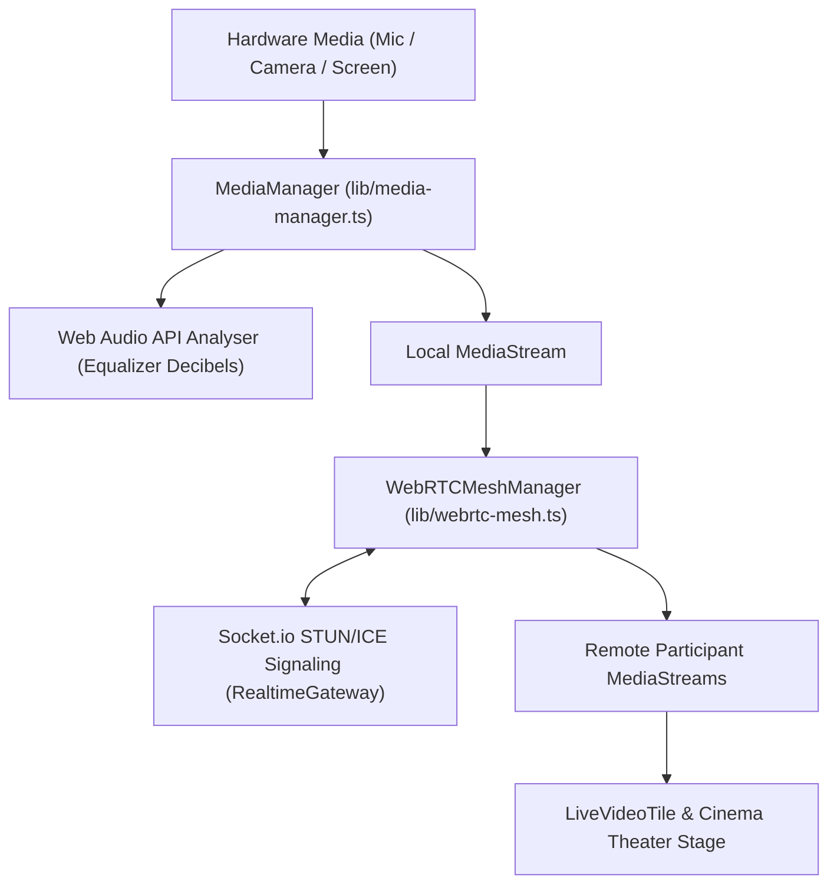

# Mivo WebRTC Media Pipeline & Interactive Stage Specification

## 1. Overview & Architecture
Mivo connects real hardware devices (Microphones, HD Webcams, Display/Screen Capture) and establishes peer-to-peer WebRTC mesh streaming across all room participants with ultra-low latency.

---

## 2. Core Capabilities

### A. Real Hardware Capture & Fallback Engine
1. **Microphone**:
   - `getUserMedia({ audio: true })`
   - Real-time decibel analysis via Web Audio API `AudioContext` & `AnalyserNode`.
   - Audio tracks are dynamically enabled/disabled on mute.
2. **Webcam**:
   - `getUserMedia({ video: { ideal: 1280x720 } })`
   - Real-time attachment to `<video autoPlay playsInline muted />` in `LiveVideoTile`.
3. **Screen Share**:
   - `getDisplayMedia({ video: { cursor: 'always' } })`
   - Real-time attachment to dominant 16:9 cinema viewport in `SCREEN_SHARE` mode.
4. **Synthetic Fallback Pipeline**:
   - In testing or headless environments, generates a 60fps HD Canvas stream so interfaces never break.

### B. Interactive Stage & Tile Controls
- **HTML5 Drag & Drop**: Grab tiles by the `GripVertical` handle to reorder participants.
- **Spotlight Mode**: Click `Pin` to expand any speaker into a dominant 16:9 stage with an attendee filmstrip below.
- **Individual Peer Volume**: Adjust each participant's volume from 0% to 200%.
- **Live 3-Bar Audio Equalizer**: Pulsating green decibel waves on the nameplate when speaking.
